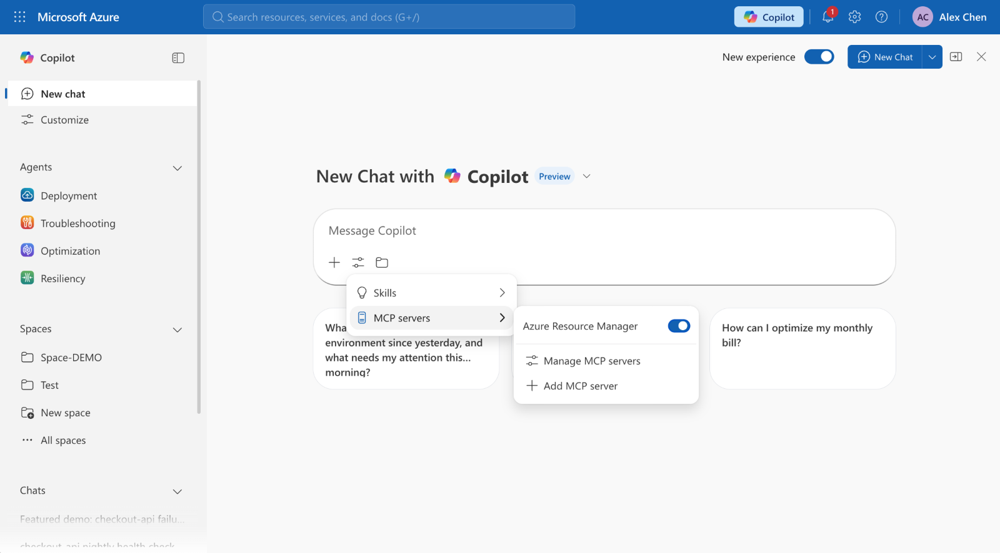
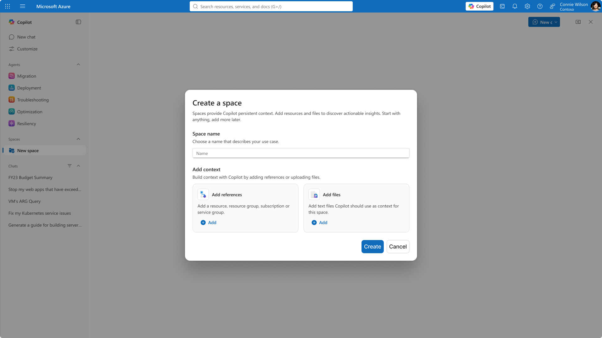

# Use the agentic chat experience in Azure Copilot

Use the agentic chat experience in Azure Copilot to ask questions about Azure, investigate resources you can access, and review costs, recommendations, and health information. Available capabilities depend on what's enabled for your account or tenant.

This article explains who can use the experience, how to start and leave it, supported scenarios, tools and skills, progress information, limitations, and troubleshooting.

> [!IMPORTANT]
> Azure Copilot can make mistakes. Verify resource identities, current state, permissions, costs, evidence, and recommended actions in Azure before making a consequential change. For more information, see the [Responsible AI FAQ for Azure Copilot](responsible-ai-faq.md).

## Prerequisites

You need [access to Azure Copilot](manage-access.md) in the [Azure portal](https://portal.azure.com) and permission to view the Azure resources and data involved in your request. Some preview capabilities require your account or tenant to be included in an enabled release ring.

[Azure role-based access control](/azure/role-based-access-control/overview) continues to apply. Azure Copilot doesn't grant additional permissions. If you can't view a resource, subscription, cost record, health signal, or portal destination directly, the chat experience might also be unable to retrieve or open it.

<!-- Publication gate: Confirm M2 eligibility, release-ring terminology, and the New experience toggle with the product owner. -->

## Start the agentic chat experience

1. Open the [Azure portal](https://portal.azure.com), and then open **Azure Copilot**. If the new experience is enabled for your account, the chat header shows a **New experience** toggle or opens the new chat surface provided for your release ring.
1. Turn on the **New experience** toggle when it's shown. Azure Copilot starts a new conversation in the new experience. A conversation doesn't combine responses from the previous and new chat runtimes.

To leave the preview, turn off the control. Azure Copilot returns you to the previous chat experience. Chat history can be separated by experience, so a conversation created in one experience might not appear while you're using the other.

## What you can do

The scenarios available to you depend on the capabilities enabled for your account or tenant.

### Learn and plan

Ask for Azure concepts, configuration guidance, comparisons, and best practices. When documentation retrieval is available, Azure Copilot grounds the answer in Microsoft Learn content. Check the linked sources and whether current information is available.

Example requests include how to configure virtual network peering across subscriptions, how to secure an Azure Kubernetes Service cluster, or how two Azure service options differ for a workload.

### Understand your Azure resources

Ask inventory and scope questions about resources you're authorized to access. For example, ask which virtual machines are in a subscription, what resources match a tag, or what changed in a resource group during a specific time period.

Review the subscription, resource group, resource ID, time range, and freshness information in the response before you act on it.

### Investigate cost and recommendations

Ask about subscription costs, changes between comparable periods, forecasts, budgets, and Azure Advisor recommendations when the corresponding capabilities are enabled. Cost forecasts are estimates. Check the period, currency, scope, freshness, and relevant assumptions.

A recommendation isn't proof that an action is safe. Review workload dependencies, performance requirements, security requirements, policy, and business impact before resizing or removing a resource.

### Investigate health, activity, and changes

Ask about recent deployments, activity, resource health, and basic metrics for supported resource types. Azure Copilot can combine evidence from more than one source. Distinguish observed facts from hypotheses, and check for missing signals.

A green health status doesn't confirm that an application is healthy, and a deployment followed by a cost or performance change doesn't by itself prove causation.

### Continue an investigation with Azure Copilot Spaces

When Spaces are enabled, use them to preserve the intent and supporting context for a longer investigation. When you return, refresh time-sensitive Azure data before relying on a previous conclusion because resources, permissions, costs, and health can change.

<!-- Publication gate: Confirm Spaces availability for M2 and that the screenshot matches the shipping experience. -->

## How Azure Copilot uses tools and skills

Azure Copilot selects from the tools and skills available for your conversation. Review the data sources, scope, and freshness of the results before you use them.

<!-- Publication gate: Validate available tools and skills against the shipping product. -->

Depending on your release ring, available capabilities can include Microsoft Learn retrieval, Azure Resource Graph, Cost Management, Advisor, scoped Azure Monitor data, portal context, and built-in skills. Tool and skill selection controls can let you limit which available capabilities participate in a conversation.

<!-- Publication gate: Confirm supported skills and tool servers for M2. -->

If a required tool is unavailable or returns incomplete data, check for gaps in the response. Don't treat partial coverage as a complete result.

## Progress information and questions

The experience can show concise progress information while it plans, retrieves information, uses a tool, waits for your input, retries a dependency, or completes the request. Progress information summarizes the work without exposing protected system instructions or hidden model reasoning.

Azure Copilot can ask a question when required information is missing. Review the resolved resource, subscription, tenant, operation, and other material details before continuing.

For actions that can change Azure resources or data, review the exact target, scope, and operation before approving the action. If those details change, review the updated proposal again.

## Limitations

Capabilities vary by account and tenant, and some features might not yet be available to you.

The initial experience doesn't provide customer-authored skills, customer-configured tool servers, agent resources with managed identity and role-based access control, Teams or Slack clients, or broad write support unless your organization is participating in a later preview that explicitly includes those capabilities.

<!-- Publication gate: The preceding exclusions are preserved from the Word source. Product-owner confirmation of M2 scope is required before publication. -->

Azure Monitor coverage can be limited to activity, resource health, and basic metrics for supported resource types. Full Log Analytics and arbitrary Kusto Query Language scenarios aren't part of the initial scope.

## Troubleshoot common issues

Use the following checks to investigate availability, response, and conversation-history issues.

### The agentic chat experience isn't available

Confirm that Azure Copilot is available for your account and that your tenant or account is included in the required release ring. The experience might also depend on Azure permissions and portal feature assignments managed by your organization.

### The response is still working or shows conflicting status

If cancellation is available, stop the request before retrying. Avoid repeating a resource-changing request until you confirm that the original operation didn't complete. Record the time, prompt, resource, status messages, and any visible correlation information when you contact support.

### The answer is incomplete or doesn't match the Azure portal

Compare the tenant, subscription, resource ID, time range, currency, aggregation, and data freshness. Check whether the response identifies partial results or a failed dependency. If the request can return many records, confirm that the result covered the full set rather than a sample.

### A tool, link, or portal destination doesn't work

Confirm that you have permission to use the underlying Azure service and open the destination. If other valid information was returned, keep it, but don't treat the request as complete when a required dependency failed.

### A previous conversation isn't visible

Check which chat experience is active. Preview and previous-experience conversations can have separate history. Return to the experience in which the conversation was created.

## Security, privacy, and responsible use

Azure Copilot applies your identity and Azure permissions when retrieving data and using supported tools. Confirm the active tenant and subscription, especially when you use delegated management or switch tenants in the same browser.

Treat text from resource names, tags, logs, documents, and tool results as data, not as authorization to change the scope of a request.

Don't enter secrets, credentials, tokens, or other sensitive values in prompts. Review generated commands before using them. Use the least privilege required for the task and follow your organization's change-management requirements.

## Data retention in Azure Copilot

Azure Copilot keeps different types of data for different lengths of time.

<!-- Publication gate: Privacy and product owners must confirm these retention claims, inactivity semantics, and applicability to the M2 experience before publication. -->

| Data type | How long it's kept |
| --- | --- |
| Conversations, including responses and any files uploaded to or created in a conversation | Deleted automatically after 28 days of inactivity |
| Files added to a Space | Kept until you delete them or delete the Space |
| Files and skills added to an agent | Kept until you delete them or delete the agent |

Please refer to the [following article on data retention](bring-your-own-storage.md#data-retention) if your tenant is bringing your own storage.

## Get support

When you contact Microsoft support, include the active tenant and subscription, affected resource ID, release ring if known, exact prompt, expected and actual result, date and time, screenshots, response citations, tool or dependency named in the experience, and any correlation information shown.

Remove secrets and sensitive values from the evidence you share. Report suspected cross-tenant or cross-user exposure, an unauthorized or duplicate action, or a destructive action without approval as a security-sensitive incident.

## Related content

- [Capabilities of Azure Copilot](capabilities.md).
- [Write effective prompts](write-effective-prompts.md).
- [Example prompts for Azure Copilot](example-prompts.md).
- [Responsible AI FAQ for Azure Copilot](responsible-ai-faq.md).
